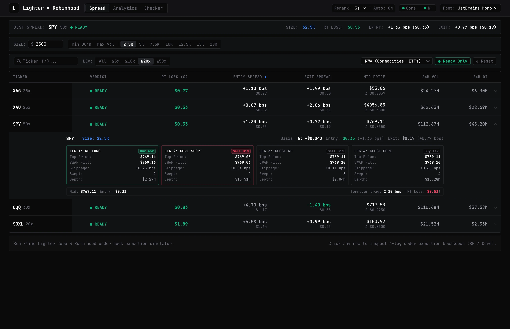
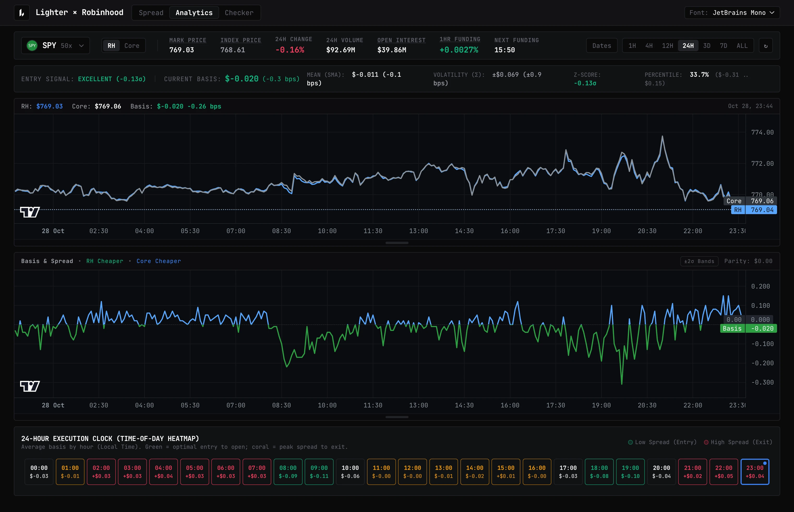
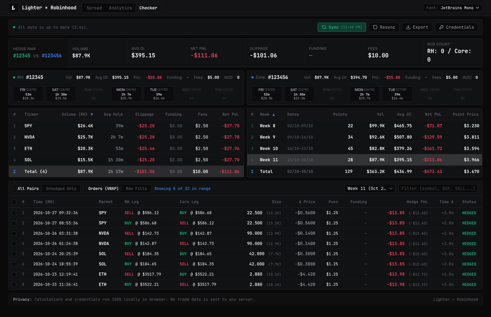

# ⚡️ Lighter × Robinhood Quant & Hedge Suite

Монорепозиторий аналитического веб-терминала и круглосуточного Telegram-монитора для дельта-нейтрального хеджирования и арбитража спредов между **Robinhood Lighter** и **Lighter Core (Mainnet)**.

Проект разделен на два независимых приложения в едином пайплайне:

1. **🖥 Web Terminal (`apps/web` — Cloudflare Pages):** Zero-framework MPA-терминал для симуляции исполнения в стаканах, статистического анализа базиса (Z-Score / Heatmap) и 100% локального аудита сделок в браузере.
2. **🤖 Telegram Monitor Bot (`apps/bot` — Cloudflare Workers + D1):** Serverless-бот для 24/7 мониторинга открытых позиций, ценовых импульсов и рисков ликвидации на бесплатном тарифе Cloudflare (`$0/мес`).

---

# 🖥 Часть 1. Web Terminal (`apps/web`)

Сверхбыстрое многостраничное приложение (Vanilla TypeScript + Vite MPA + Tailwind v4) без тяжелых UI-фреймворков. Работает напрямую с DOM, WebSocket-потоками стаканов и локальной базой `IndexedDB`.

## 1. Симулятор спреда и стаканов (`/spread`)



Реалтайм-сканер и симулятор исполнения арбитражных сделок между **Lighter Core** и **Robinhood Lighter** по фактической глубине L2-стаканов (Order Book):

- **Симуляция 4-ногого исполнения (4-Leg Execution Breakdown):** рассчитывает реальную цену входа и выхода с учетом проскальзывания в стакане под выбранный объем позиции (`$1.5K`, `$2.5K`, `$5K` ... `$20K` или кастомный размер).
- **Оценка стоимости круга (`RT LOSS $`):** мгновенное ранжирование пар по суммарным потерям на вход/выход в долларах и базисных пунктах (`ENTRY SPREAD` / `EXIT SPREAD` в `bps`).
- **Умная фильтрация и авто-реранк:** пресеты `Min Burn` и `Max Vol`, фильтр по максимальному плечу (`>=5x` ... `>=50x`), категориям активов (`RWA`, `Commodities`, `ETFs`, `Crypto`) и автоматическая пересортировка каждые `3s` без сброса фокуса.
- **Прямой WebSocket-стриминг:** одновременное удержание соединений с обеими сетями (`🟢 Core` / `🟢 RH`) с индикацией статуса коннекта.

## 2. Квантовая аналитика базиса (`/analytics`)



Статистический терминал для поиска оптимальных точек входа и выхода из спреда на основе исторического расхождения цен:

- **Квантовые метрики в реальном времени:** автоматический расчет `Z-Score` (например, `+0.96σ`), `Percentile` (`83.3%`), скользящего среднего `MEAN (EMA)`, волатильности базиса `VOLATILITY (σ)` и торгового сигнала (`ENTRY SIGNAL: FAIR / CHEAP / EXPENSIVE`).
- **Двухуровневые графики (TradingView Lightweight Charts):**
  - Синхронный график цен маркировки `RH` vs `Core` с отображением текущего базиса в `$` и `bps`.
  - График отклонения базиса (`BASIS & SPREAD`) относительно паритета (`$0.00`) с динамическими полосами Боллинджера (`±2σ Bands`), разделенный на зоны _RH Cheaper_ и _RH More Expensive_.
- **24-Hour Execution Clock (Time-of-Day Heatmap):** почасовая тепловая матрица (00:00 – 23:00 Local Time), агрегирующая средний исторический базис для каждого часа суток. Позволяет визуально определить часы с минимальным спредом для набора позиции (зеленые слоты) и пиковым спредом для разгрузки (коралловые слоты).

## 3. Локальный аудитор хеджа (`/checker`)



Инструмент сверки истории сделок, комиссий и эффективности хеджирования между двумя биржами:

- **100% Client-Side Privacy (`IndexedDB`):** Read-Only токены (`ro:...`) и вся выгруженная история ордеров хранятся и обсчитываются исключительно локально в браузере пользователя. Никакие торговые данные не отправляются на внешний сервер.
- **VWAP-сверка хедж-пар (`Orders VWAP` & `Raw Fills`):** автоматическое сведение ордеров `RH Leg` и `Core Leg` в единые синтетические позиции с расчетом дельты времени исполнения (`Time Δ`), разницы цен (`Δ Price`), проскальзывания (`Slippage`), уплаченного фандинга (`Funding`) и чистого `Hedge PnL`.
- **Детекция рассинхрона (`Unhedged Only`):** мгновенный фильтр по «одноногим» или не полностью перекрытым сделкам.
- **Календарь активности и поинтов:** понедельная и подневная разбивка проторгованного объема (`Volume`), среднего открытого интереса (`Avg OI`), комиссий и количества вводов/выводов (`W/D Count`) отдельно по каждому аккаунту.

---

# 🤖 Часть 2. Telegram Monitor Bot (`apps/bot`)

Когда позиции открыты через терминал, бот берет на себя круглосуточный надзор за ценовыми импульсами, маржой и расстоянием до ликвидации. Спроектирован специально под жесткие лимиты **Cloudflare Workers Free ($0/мес)**.

## 👀 Демо интерфейса бота

### 1. Импульсный алерт цены и риска позиции

Бот отслеживает движение цены против открытых позиций трейдера. Если на одном тике срабатывают триггеры сразу по нескольким кошелькам или рынкам, бот склеивает их в единый дайджест (разделитель `─────────────`), чтобы не спамить в чат и не упираться в лимиты Telegram:

```text
⚡️ ETH [RH] — $2,480.50
💼 #12345 (Main Hedge) • 🔴 SHORT

• Импульс: ↗️ +1.24% (с $2,450.00)
• Позиция: 📉 -$352.50 (+2.92% от $2,410.00)
• Ликвидация: $2,535.00 (до неё 2.15%)

[ 🔄 Обновить ] [ 🌐 Открыть биржу ]
[ 🔕 1ч ] [ 🔕 4ч ] [ ⏸ Выкл ]
```

### 2. Сводка открытых позиций (`/positions`)

Мгновенная сводка по всем подключенным счетам с расчетом совокупного PnL и маржи. При возрасте данных в D1 менее 10 секунд ответ отдается за **40–60 мс**, при устаревании или нажатии кнопки «🔄 Обновить» выполняется синхронный запрос к бирже:

```text
💼 #12345 (Main Hedge) [RH] • $12,450.00

🟢 LONG BTC • 0.5
• Вход: $68,200 ➔ Марк: $69,100
• UnPnL: 📈 +$450.00
• Ликвидация: $61,400 (🛡11.10%)
─────────────
💼 #123456 (Arb Short) [Mainnet] • $8,200.00

🔴 SHORT BTC • 0.5
• Вход: $68,250 ➔ Марк: $69,100
• UnPnL: 📉 -$425.00
• Ликвидация: $75,100 (🛡8.60%)
─────────────
📊 ИТОГО:
• UnPnL: 📈 +$25.00
• Маржа: $20,650.00

🕒 Кэш от: 14:32:00 UTC

[ 🔄 Обновить ] [ ⚙️ Настройки ]
```

### 3. Таргет спреда RH vs Core (`/targets`)

Мониторинг расхождения цен между **Robinhood Lighter** и **Lighter Core** с защитой от ложных проколов (подтверждение 3 тика подряд) и JIT-проверкой реальной глубины стакана (Ask/Bid):

```text
🎯 SPY • Таргет достигнут!

🟢 Условие: RH < Core на ≥1.0 bps
📊 Исполняемый спред стакана: +1.25 bps (+$0.097)
• 🟠 RH Ask: $774.36 (объём: 1.9 SPY / $1.5K)
• ⚡️ Core Bid: $774.26 (объём: 45.3 SPY / $35K)

[ 🔕 1ч ] [ 🔕 4ч ]
[ 🔕 24ч ] [ ⏸ Выкл ]
```

---

## ⚡️ Архитектура крона и лимиты Cloudflare Free

Главная проблема мониторинга на бесплатном тарифе Cloudflare Workers — жесткий потолок в **50 исходящих `fetch`-запросов (Subrequests)** и **50 мс CPU** на один запуск крона.

Чтобы не опрашивать каждый аккаунт по отдельности (проблема `N+1`), бот использует архитектуру **Reverse Indexing**, **HFT Guard** и **Smart JIT**:

```text
[Cron Tick: каждую 1 мин]
   │
   ├─► 1. Параллельный снимок рынков (2 subrequests, 0-я мс)
   │      Одновременный запрос fetchExchangeStats для RH Lighter и Lighter Core.
   │      Чтение активных символов и таргетов спреда из D1.
   │
   ├─► 2. Проверка таргетов спреда (/targets)
   │      • Фильтр ложных спайков: подтверждение 3 тика подряд (min_consecutive_hits = 3).
   │      • JIT-валидация стаканов: запрос глубины Ask/Bid перед алертом.
   │      • Гистерезис re-arm: цель перезаряжается только при откате спреда <= 80% от порога.
   │
   ├─► 3. Reverse Indexing активных рынков (~1.0–2.5 мс CPU)
   │      Отсечение пар с изменением цены < 0.05% через in-memory кэш priceReferenceCache (TTL 10 мин).
   │      Выборка из D1 только открытых позиций по реально сдвинувшимся тикерам.
   │
   ├─► 4. HFT Guard: разделение очередей синка
   │      • Спокойный рынок: фоновый Round-Robin опрос пачки до 5 аккаунтов (спящие с $0 пропускаются)
   │        с Zero-Alloc Fingerprint Dirty Checking (пропуск записи в D1 при неизменных позициях).
   │      • Активный рынок: фоновый синк отключается; включается селективный JIT (до 6–10 аккаунтов)
   │        только для позиций в зоне риска (<= 5.0% до ликв) с очисткой ликвидированных зомби-позиций.
   │
   └─► 5. Пакетная доставка в Telegram (до 38 subrequests)
          Склейка алертов по telegram_id: 1 юзер = 1 дайджест (защита от HTTP 429).
          Авто-отписка заблокировавших бота пользователей (HTTP 403 Forbidden).
          Защитный потолок MAX_SUBREQUESTS_PER_CRON = 45 и таймаут Wall-Clock 14 секунд.
```

### Бюджет ресурсов и эксплуатационная емкость ($0/мес)

Метрики верифицированы нагрузочным стендом (`apps/bot/load-tests/profile_engine.ts` и `simulate_cron_tick.ts`):

| Метрика / Параметр             | Лимит CF Free        | Штатный режим (Zero-Lag)                            | Пиковый предел под нагрузкой         |
| :----------------------------- | :------------------- | :-------------------------------------------------- | :----------------------------------- |
| **Subrequests (`fetch`)**      | `50` / тик крона     | `2` (цены) + `5` (Round-Robin) + `до 38` (Telegram) | **Жёсткий кап 45/50**                |
| **CPU Time (Scheduled)**       | `50 мс` / тик        | `2.5 – 5.9 мс` (запас ~90%)                         | `~8.5 мс`                            |
| **Wall-Clock время**           | `20 сек`             | `~1.2 – 3.5 сек`                                    | `14.0 сек` (защитный таймаут)        |
| **D1 Запись / Чтение**         | `100K` / `5M` в день | `~17K` записей / `~100K` чтений                     | до `90K` записей/день                |
| **Пользователей / Кошельков**  | —                    | **300–500** юзеров / **1 500** счетов               | **до 800** юзеров / **3 000** счетов |
| **Активных позиций в базе**    | —                    | **1 000 – 2 500** позиций                           | **до 5 000** позиций                 |
| **Задержка доставки алерта**   | —                    | **0 – 60 сек** (тот же тик)                         | **1 – 2 мин** (очередь при обвале)   |
| **Отклик меню (`/positions`)** | —                    | **40 – 60 мс** (D1 кэш)                             | **150 – 350 мс** (force refresh)     |

### Возможности и команды бота

- **Фильтрация направления риска (`isPositionRiskIncreasing`):** движение цены в плюс для трейдера не вызывает тревожных алертов — бот лишь обновляет базовую отметку цены в базе без отправки сообщений.
- **Динамический анти-флаппинг (Smart Cooldown):** `3 мин` (при шаге `<= 0.5%`), `5 мин` (`0.5–1.0%`), `8 мин` (`> 1.0%`). При резком простреле цены (`>= 2x` от порога) кулдаун сбрасывается мгновенно.
- **Подтверждение спреда (3 тика) и JIT-стакан (`/targets`):** защита от минутных шпилек и сквизов — уведомление отправляется только при подтверждении 3 тика подряд и подтверждении наличия объема в стаканах обеих бирж.
- **Кнопочный интерфейс:** добавление кошельков по индексу с валидацией залога, настройка шага цены (`0.1% – 50.0%`, по умолчанию `0.5%`) и режим «Тихий сон» (Mute на 1ч, 4ч, 24ч или насовсем).

| Команда      | Назначение                                                             |
| :----------- | :--------------------------------------------------------------------- |
| `/start`     | Главное меню, онбординг и постоянная клавиатура управления             |
| `/positions` | Открытые позиции, маржа, PnL и дистанция до ликвидации                 |
| `/accounts`  | Управление кошельками (добавление до 10 счетов, алиасы, удаление)      |
| `/targets`   | Таргеты спреда между Robinhood Lighter и Lighter Core (до 30 таргетов) |
| `/settings`  | Настройка порога шага цены (0.1%–50%) и режимов Mute                   |
| `/stats`     | Системная телеметрия крона, D1 и квот API _(только админ)_             |
| `/help`      | Справка по командам и логике мониторинга                               |

---

# 📂 Архитектура монорепозитория

```text
.
├── apps/
│   ├── web/                        # 🖥 Web Terminal (Vite MPA + Vanilla TS + Tailwind v4)
│   │   ├── app/                    # HTML-точки входа (index, spread, analytics, checker)
│   │   ├── src/
│   │   │   ├── spread/             # Симулятор 4-leg исполнения, L2 стаканы и WS-потоки
│   │   │   ├── analytics/          # Графики базиса, Z-Score математика и 24h Heatmap
│   │   │   ├── checker/            # Локальная БД IndexedDB, VWAP-сверка хеджа и синк
│   │   │   ├── shared/             # Общий WS-клиент, пул стаканов, форматер и роутинг
│   │   │   └── hub/                # Навигационный хаб
│   │   └── test/                   # Unit-тесты математики, стаканов, синка и UI (14 сюитов)
│   │
│   └── bot/                        # 🤖 Telegram Monitor Bot (Cloudflare Workers + D1)
│       ├── schema.sql              # Схема таблиц и индексов SQLite (Cloudflare D1)
│       ├── src/
│       │   ├── bot/                # Логика grammY, визарды и форматирование дайджестов
│       │   ├── cron/               # Пайплайн минутного тика, Reverse Index и Smart JIT
│       │   ├── cache/              # In-memory кэширование внутри изолята
│       │   ├── db/                 # Prepared statements и батч-запросы к D1
│       │   ├── lighter/            # Клиент Lighter API и математика ликвидаций/спреда
│       │   └── utils/              # Трейсер перформанса, фоновые задачи и healthcheck
│       ├── load-tests/             # Профайлер движка и симуляция тика крона под нагрузкой
│       └── test/                   # Unit-тесты бота, фильтрации сквизов и БД (12 сюитов)
│
├── scripts/build_web.ts            # Пайплайн сборки статики фронтенда
├── src/index.ts                    # Корневой роутер / входная точка Worker
├── .dev.vars.example               # Шаблон локальных переменных окружения
└── wrangler.toml                   # Конфигурация Cloudflare (Workers, Assets, D1, Cron)
```

---

# 💻 Разработка и тестирование

Требования: [Bun](https://bun.sh) (v1.2+) и `wrangler`.

```bash
# 1. Установка зависимостей всего монорепозитория
bun install

# 2. Инициализация локальной базы D1 для бота
bun run d1:init

# 3. Запуск всех тестов (Web + Bot + Routing — 27 тестовых файлов / 419 тестов)
bun test

# 4. Запуск нагрузочного профилирования крона (опционально)
bun run profile

# 5. Линтинг, проверка типов и форматирование
bun run lint
bun run typecheck
bun run format:check

# 6. Локальный запуск (Web + Worker)
bun run dev
```

---

# 🚀 Деплой в Cloudflare (Workers & Assets)

### 1. База данных D1

```bash
bunx wrangler d1 create lighter-db
# Скопируйте database_id в wrangler.toml, затем накатите схему:
bunx wrangler d1 execute lighter-db --remote --file=./apps/bot/schema.sql
```

### 2. Секреты окружения (для Бота)

```bash
# Скопируйте шаблон локального окружения:
cp .dev.vars.example .dev.vars

# Настройте секреты в Cloudflare:
bunx wrangler secret put TELEGRAM_BOT_TOKEN     # Токен от @BotFather
bunx wrangler secret put TELEGRAM_SECRET_TOKEN  # Токен верификации вебхука
bunx wrangler secret put LIGHTER_API_KEY        # Read-Only ключ (ro:...) — расширяет лимит до 24,000 req/min
bunx wrangler secret put ADMIN_TELEGRAM_ID      # (Опционально) Доступ к /stats
bunx wrangler secret put HEALTHCHECK_URL        # (Опционально) Мониторинг крона
```

> **Как выпустить Read-Only токен (`ro:...`) для бота или веб-чекера:**
> Перейдите на [app.lighter.xyz/read-only-tokens](https://app.lighter.xyz/read-only-tokens/), подключите кошелек и нажмите **Create Read-Only Token**. Ключ дает доступ исключительно на чтение (без права торговли и вывода средств).

### 3. Сборка и публикация

```bash
# Сборка веб-терминала (apps/web/dist) и деплой воркера с раздачей ассетов
bun run deploy

# Регистрация меню команд и привязка Telegram-вебхука
curl "https://<ВАШ_ВОРКЕР>.workers.dev/setup-commands"
```

## ⚖️ Лицензия

Распространяется под лицензией [MIT](LICENSE).
